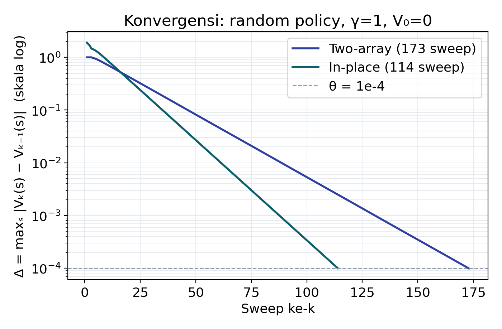
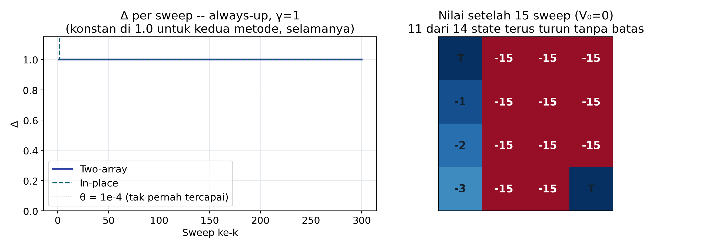

# Iterative Policy Evaluation: Two-Array vs. In-Place

Kapita Selekta (MAA) — Aditya Wahyu Wijanarko, 25/574566/PPA/07251

Implementasi dan perbandingan dua cara menjalankan *Iterative Policy Evaluation* (Sutton & Barto, Section 4.1) pada gridworld 4×4, diuji pada kebijakan acak dan kebijakan deterministik selalu-ke-atas.

Laporan lengkap: [`Laporan_Iterative_Policy_Evaluation.pdf`](./Laporan_Iterative_Policy_Evaluation.pdf)

## Hasil singkat

Pada random policy (γ=1), in-place konsisten butuh sekitar 35% lebih sedikit sweep daripada two-array untuk konvergen ke threshold yang sama. Pada kebijakan always-up, γ=1 tidak pernah konvergen untuk kedua metode (11 dari 14 state tidak pernah mencapai terminal), sementara γ=0.9 konvergen dengan jumlah sweep yang identik untuk kedua metode. Penjelasan lengkap dan buktinya ada di laporan.




## Isi repo

| File | Isi |
|---|---|
| `gridworld.py` | Environment gridworld 4×4: state, aksi, transisi, dua kebijakan (random, always-up) |
| `ipe.py` | Dua implementasi Iterative Policy Evaluation: `two_array` (Jacobi-style) dan `in_place` (Gauss–Seidel-style) |
| `run_experiments.py` | Menjalankan semua eksperimen di laporan, menyimpan hasilnya ke `results.pkl` |
| `make_figures.py` | Membaca `results.pkl`, menghasilkan tujuh figure di `figures/` |
| `figures/` | Figure hasil (juga yang dipakai di laporan) |

## Reproduksi

```bash
pip install -r requirements.txt
python run_experiments.py   # ~1 menit, menghasilkan results.pkl
python make_figures.py      # menghasilkan ulang seluruh figure di figures/
```

## Referensi

Sutton, R. S., & Barto, A. G. (2018). *Reinforcement Learning: An Introduction* (2nd ed.). MIT Press. Bab 4 (Dynamic Programming).
